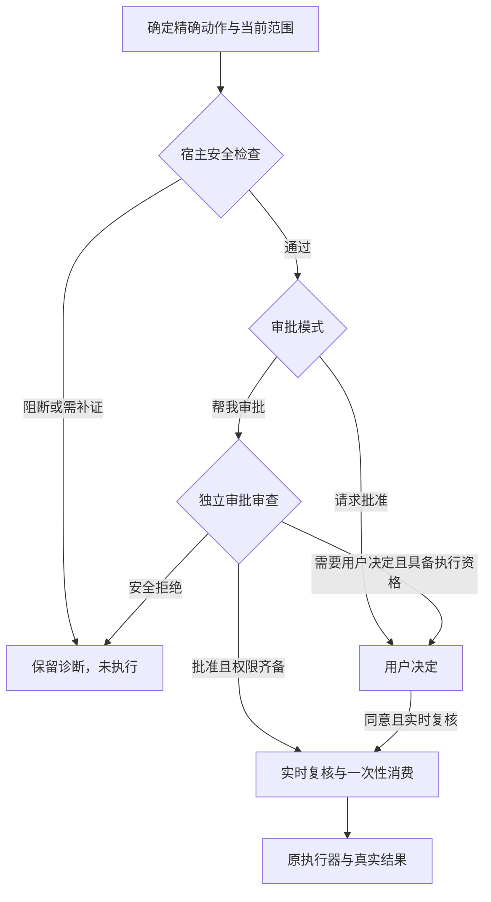

# KeepSeek「帮我审批」统一合同与验收

## 2026-11-11 v9 当前合同

实施基线为 `50938ef6c0b66ee735d4fdb5406400a3ad021d08`。审批策略为 v9，审批审计容器仍为 v1，委托审批交付仍为 v13，父会话请求和工具 schema 仍为 v15。

| 环节 | 当前行为 |
| --- | --- |
| 审批 | `delegate` 使用独立 reviewer。已知命令语义用于影响说明和结果核验。未知参数进入审查，实际启动器、工作区信任、权限范围、依赖与取消由宿主核验。`ask` 继续由用户批准。 |
| 执行 | `kmvdata.keepseek.projectExecution` 从用户设置读取，默认 `isolated`。审批绑定具体执行边界与一次性许可。用户可显式选 `host`，进程会使用 VS Code 扩展宿主账号的权限。 |
| 发布 | 明确的任务目标和用户级授权提供仓库及远端权限。宿主核实实际目的地、引用和源对象，审批模型决定本次操作。精确的 `--force-with-lease=<ref>:<expected>` 在授权充分时可保留高影响级别并获模型批准。 |
| 等待 | 服务无有效决定时保留审计及未派发原因。用户补充精确目标授权后再交给模型决定。显式恢复重新核验，独立操作可推进。 |
| 追溯 | 审计保留准确提案、执行环境、审批来源与真实结果。等待、终结前未启动、启动失败和已退出分别记录。结果未知时先核验实际状态。 |

执行段在审批交接前中断时，可以从草稿卡恢复该段的待处理编辑和命令。恢复先完成所需 Apply 与落盘核验，再重新审批依赖命令。已完成的草稿复用结果。通过静态纠错生成的替代草稿如果遇到审批服务故障，也保留可证实未派发的原草稿身份，恢复时重新审查。

仅当模型返回 `needs_user`、且结构化规则只表示 `project_behavior_unknown` 时，才使用同一次逻辑审查中的一次纠正机会。有效 `deny` 始终保存为拒绝，即使模型使用了该未知行为规则码；不再发起纠正请求，换草稿 ID 或理由也不解除拒绝。/ The bounded project-policy correction applies only to `needs_user` with the sole structured rule `project_behavior_unknown`. A valid `deny` remains a refusal, receives no correction request, and cannot be bypassed by changing a draft ID or reason.

### 执行环境 / Execution environment

| 扩展宿主 | 隔离条件 |
| --- | --- |
| macOS | 系统 Seatbelt 可建立进程沙箱。工作区与专用临时目录可写，受控系统工具链可读。 |
| Linux / WSL 扩展宿主 | 系统 `bwrap` 和用户命名空间可用，架构为 x64 或 arm64。工作区与临时目录可写，工具链以只读方式挂载。网络命名空间和 seccomp 限制项目进程的套接字访问。 |
| 原生 Windows | Docker Desktop Linux 引擎可用，且用户设置 `kmvdata.keepseek.projectExecutionContainerImage` 指向可信的本机镜像 `sha256:<64 位十六进制>`。镜像需提供 `/usr/bin/env`、GNU `/usr/bin/timeout` 和所需 Linux 工具链，例如 Node、npm 和 Git。命令的工作目录映射到容器内，CLI 路径应适配容器环境。 |

通用隔离进程及其子进程使用受控工具和环境，无外部网络。Git 发布使用独立的受控传输。`host` 适用于愿意主动授权扩展宿主账号权限的可信开发环境。隔离不可用时会记录具体缺失条件。

原生 Windows 的容器只提供镜像里的 Linux 工具。如果任务依赖 Windows 原生 `.exe`、批处理或工程外的 Git 工作树元数据，须选用支持这些依赖的执行环境。

在 VS Code 的用户设置中搜索 `KeepSeek: Project Execution`。原生 Windows 还可搜索 `KeepSeek: Project Execution Container Image`。容器中使用已安装的 Linux 工具及项目相对路径。仓库设置无法切换这些执行条件。

Windows 上可运行 `docker image inspect --format '{{.Id}}' <本机工具链镜像>`，把返回的 `sha256:…` 填入用户设置。镜像内应预装项目所需工具和依赖。通用隔离进程无法访问包仓库或发布服务，当前受控远端通道覆盖 Git 查询与推送。

支持原生隔离的 macOS 和 Linux 上可用以下命令运行回归。隔离后端不可用时，测试会报告失败。

```bash
bun run build:test
KEEPSEEK_REQUIRE_NATIVE_ISOLATION=1 node --test out-test/test/projectExecutionIsolation.test.js
```

原生 Windows 的隔离回归使用预装 Node 的 Linux 镜像。在 PowerShell 中指定镜像 ID，再运行对应测试。

```powershell
$env:KEEPSEEK_TEST_DOCKER_IMAGE = 'sha256:<本机镜像 ID>'
bun run build:test
node --test out-test/test/projectExecutionWindows.test.js
```

常规停止和超时会终止启动的进程组。Windows 同时强制移除本次容器，并由容器内的截止时间约束扩展宿主异常退出后的业务命令。macOS 自行建立独立会话的子进程仍继承 Seatbelt 权限，可能在父进程组收到停止信号后继续运行。文件边界以实际路径和挂载为基础，工程中预先存在的同卷硬链接与其工程外别名共享 inode。需要排除这类写入时，使用独立的工程副本。启动包装器后应按实际退出和业务证据判断命令结果。

### 远端授权 / Remote authorization

在用户设置中以真实仓库和有效远端配置 `kmvdata.keepseek.gitReleaseGrants`。`read` 指定核验用的分支或标签，`push` 指定可推送引用或限定名称前缀，`rewrite` 可指定已授权改写的精确分支。任务仍需提出实际推送目标。明确写出有效远端和目标引用的任务也可提供本次目标权限。HTTPS 私有仓库可通过 `credentialEnvironment` 引用宿主的仓库专用令牌变量，并用 `credentialUsername` 指定公开用户名，默认 `x-access-token`。用户设置只保存变量名。发布审查和验收使用临时裸仓库或自有测试远端。

常设授权服从用户在当前任务里明确指定的目的地、引用和改写条件。任务首次核实的有效目的地随原始用户任务保存，重启后仍按该目的地核验。每次推送最多绑定 30 个目标引用，审查材料另含仓库和目的地。审批模型会在有界审查材料中保留最近三条真实任务指令，优先采用最新适用约束。

用户级设置示例

```json
{
  "kmvdata.keepseek.gitReleaseGrants": [
    {
      "repository": "D:\\Projects\\example",
      "destination": "https://github.com/example-owner/example.git",
      "read": ["refs/heads/main"],
      "push": ["refs/heads/main"],
      "credentialEnvironment": "KEEPSEEK_EXAMPLE_GIT_TOKEN"
    }
  ]
}
```

传输前解析 Git 配置中的推送 URL 和改写规则，并将解析后的唯一目的地交给模型。实际发送使用隔离的临时 Git 元数据，HTTPS 强制证书验证并关闭重定向。原生 Windows 支持 HTTPS 和符合条件的本地裸仓库。直连 SSH 由支持的 POSIX 宿主提供。

### 现场验收 / Field acceptance

1. 在各目标平台的可信临时仓库选择「帮我审批」。用受控 reviewer 或可审计的测试模型执行 `git ls-files -s -- game_pywin.log game_pywin.log.1 game_pywin.log.2 game_pywin.log.3`、`git log --oneline --all -- game_pywin.log`、`git log --oneline -- game_pywin.log`、`git status --porcelain=v1`。放置一个干净的已跟踪日志文件，并让一个日志提交只存在于另一条分支。
2. 准备带未知业务参数的本地脚本，再准备一个独立读取。记录每个命令的 exact argv、review、启动、退出及影响。再让脚本的子进程尝试访问工程外的夹具或网络；检查外部标记、系统文件和未经授权远端均无变化。
3. 明确授权一次精确分支推送至隔离远端。核对授权来源、实际目标、源提交、模型决定、远端 ref read-back 和人工卡次数。审查后改绑远端或移动源提交，核对旧决定失效。
4. 模拟 reviewer 无效回复、超时、显式拒绝和宿主重启。检查等待项及依赖未派发，已完成项的进程不重跑，恢复先验证当前权限、状态与模型决定。

当前开发环境为受限 macOS 宿主。`/usr/bin/sandbox-exec -p '(version 1) (allow default)' /usr/bin/true` 返回 `sandbox_apply: Operation not permitted`，Docker daemon socket 连接也返回 `Operation not permitted`。此环境还拒绝绑定用于 HTTPS Git 回归的本地端口。平台原生隔离及线上传输结果应由支持的扩展宿主按上述步骤记录。带显式 `host` 设置的测试夹具只能证明审批及真实派发行为。

### 固定验证回归 / Fixed validation regression

原生 F5 验收补充 / Native F5 checks:

| 中文 | English |
| --- | --- |
| 默认隔离环境就绪后，打开可信临时工程，选择「帮我审批」。创建或修改带空格、Unicode 路径的 JS/Python 入口，再运行；核对 Apply/read-back 在启动审查前完成，进程只启动一次，人工卡为零。Windows 容器使用镜像内的 Linux 解释器及项目相对路径。 | With isolation ready, open a trusted temporary project and select **Approve for me**. Create or edit JS/Python entries with spaces and Unicode paths, then run them. Verify Apply/read-back precedes launch review, one process starts, and no manual card appears. On Windows, use the container's Linux interpreter and project-relative paths. |
| 隔离环境缺失时核对明确的未派发原因，不能静默回退到宿主。仅在愿意使用宿主权限时，由用户在用户级设置中选择 `projectExecution=host` 后重复上述用例。 | If isolation is unavailable, check the explicit non-dispatch reason and absence of a silent host fallback. Repeat with the user-level `projectExecution=host` setting only when host privileges are intentionally selected. |
| 用受控 reviewer 返回有效 `deny`，即便规则码为 `project_behavior_unknown`，也应只有一次请求且零副作用。改草稿 ID、理由或切换 ask 后重复，仍不能绕过该拒绝。 | Return a valid `deny` from a controlled reviewer, even with `project_behavior_unknown`. Expect one request and zero effects. A changed draft ID, reason, or switch to ask must not bypass the refusal. |

```bash
bun run build:test
node --require ./out-test/test/registerVscodeStub.js --test \
  out-test/test/validationAvailability.test.js out-test/test/runnerValidationState.test.js
```

真实 npm 夹具核对了 `compile`、`lint`、`test` 的审批与执行结果。模拟用户补充授权后，验证在独立模型第二次审查批准前无标记文件，随后只写一次。另测第二次审查不可用、执行环境更改、外部 URI 改绑，均验证无受影响动作派发。

固定验证保留脚本的实际参数语义。`sh -c` 的命令文本可以进入审批。隔离模式下，工程内 `.npmrc` 进入本次快照哈希，配置内容不会发送给审批模型。审批暂停时，已有不可变证据的独立分页读取可先完成并持久化，恢复时复用该页。

### v9 本次复核证据 / Verification evidence

复核以 `50938ef6c0b66ee735d4fdb5406400a3ad021d08` 及当前未提交 v9 改动为基础，保留并行会话的实现。补充修正了有效 `deny` 被未知行为纠正路径再次送审的问题。对应行为回归还检查改目标 ID 和理由不能绕过该拒绝。

以下临时工程使用真实 SafeFileEditor 和 SpawnDraftRunExecutor，reviewer 由受控响应桩驱动，显式选择宿主执行。计数代表回归夹具，不代表线上模型或原生隔离已验收。

| 场景 | Apply | 真实进程启动 | 逻辑审查 | reviewer 调用（桩） | 人工弹窗 |
| --- | --- | --- | --- | --- | --- |
| delegate：48 KiB Node 入口、空格与 Unicode、一次未知行为纠正 | 1 | 1 | 2 | 3 | 0 |
| delegate：Python 修改后使用真实 `.venv` 启动 | 1 | 1 | 2 | 2 | 0 |
| ask：同类 Node/Python 操作，点击前（各用例） | 0 | 0 | 0 | 0 | 0 |
| ask：显式点击后（各用例） | 1 | 1 | 0 | 0 | 0 |

上述回归检查落盘内容、精确 argv、read-back 在启动审查前完成，以及重复提交无新增进程。Git 查询回归另实际启动 21 次（20 次 delegate、1 次 ask），其中 9 次为 verify 查询；历史结果重放启动数为零。

对 `7c0aec40adb2ef4d4b30f07f77e0a78a54f16c94` 使用相同 TypeScript 编译选项加载后逐字节比较：英文 system 11,064 字节、中文 system 9,601 字节、工具 JSON 26,375 字节，全部一致；工具 SHA-256 为 `5eedfab6cb618ad1c27c9491247b50c65a2932ad1db4b8499deecea4493450d5`。当前策略 v9，审批审计容器 v1，交付协议 v13，请求与工具 schema v15。

本次执行环境为 macOS、Node v24.15.0、Bun 1.3.12。

| 命令 | 退出码 | 本次实测 |
| --- | --- | --- |
| `bun run compile` | 0 | 编译通过 |
| `bun run lint` | 0 | 静态检查通过 |
| `bun run build:test` | 0 | 测试构建通过 |
| `bun run test` | 0 | 1,660 项：1,658 通过、0 失败、2 跳过、0 取消；701.358 秒 |
| `git diff --check` | 0 | 补丁格式检查通过 |

两项跳过分别为原生 Seatbelt 隔离进程和本地故障服务器：当前工具宿主禁止创建相应沙箱或绑定监听端口。原生 VS Code F5、Windows/Linux 实机、线上审批模型及真实外部传输未在本轮验收。本文的 v7 I/O 对照仍为当时的历史计数，不能当作新增平台隔离后的 v9 性能数字。

### 2026-11-12 交付复验

基于 `50938ef` 的最终工作树通过 `bun run compile`、`bun run lint`、`bun run build:test`、`git diff --check` 和 `bun run test`。全量 1,669 项，1,666 通过、0 失败、3 跳过。跳过项为本宿主禁止创建的 Seatbelt 子沙箱、需要原生 Windows 的 Docker Desktop 用例，以及本宿主禁止绑定端口的本地故障服务器。

| 场景 | 实测 |
| --- | --- |
| 现场四条 Git 查询 | 精确 argv 对应四次独立审查和四次真实启动，人工确认零次。索引返回干净的已跟踪日志，`--all` 返回另一分支的提交。 |
| 同一任务连续审批 | 原样送审精确 pager 查询。格式错误的提交先修正，再执行一次有效提交。连续批次沿用任务身份和累计预算。 |
| 受控 Git 发布 | 临时裸仓库验证普通推送、精确租约、原子分支与标签、远端改绑和结果丢失后的 ref 核验。 |
| 暂停与恢复 | 未入队编辑和命令恢复后按依赖审批。Python 替代草稿复审后实际启动一次。固定验证等待期间保存独立证据分页，恢复时复用。 |

审批模型使用受控响应，命令与 Git 夹具使用真实进程。原生 VS Code F5、原生平台隔离、线上审批模型以及外部 HTTPS/SSH 仍需现场验收。

## 2026-11-11 v8 历史合同

实施基线为 `987b10caa2d55cd443afd73620cc30d43cec0b77`，KeepSeek 0.5.3，Asia/Shanghai。审批策略为 v8，审批审计容器仍为 v1，委托审批交付仍为 v13，父会话请求和工具 schema 仍为 v15。新 delegate 用户消息追加当前审批说明，已保存的请求字节沿用原文。

| 环节 | 行为 |
| --- | --- |
| 请求批准 / Ask for approval | 走用户批准路径，reviewer 请求数为零。适用的宿主安全阻断与安全拒绝继续生效。 |
| 帮我审批 / Approve for me | 宿主核验后由独立、无工具 reviewer 审查可信工程内的普通变更和启动。先 Apply 并完成落盘复核，再审查依赖本轮文件的实际命令版本。解释器内联代码按精确内容、实参、cwd 和效果审查。 |
| 有效决定 | 自动批准仅签发当前动作的一次性授权。具体、可由用户确认的风险或精确授权缺口显示影响范围、风险和批准一次/拒绝入口。 |
| 审查故障 | 协议校验保留字段和失败类别，同一次逻辑审查最多额外尝试一次，共用原请求期限和根任务预算。无效回复、超时、配置和服务故障经宿主资格复核后可选择重新审批或精确人工处理。范围不符先重新核验。不可用记录中的默认 high 表示审查缺失，不能签发执行许可。 |
| 等待与恢复 | 批次发布持久化请求后释放审批执行槽。独立项继续，声明或可核验的依赖保持未派发等待。模型时限、人工等待、短时执行 permit 分别计算。关闭 Webview 保留当前宿主的请求。重启恢复等待意图、审计和依赖，显式恢复会重新核验并签发新请求。 |
| 副作用 | 精确点击经重新核验和审计落盘后，文件沿用 SafeFileEditor，命令仍以一次性 permit 调用 `spawn(executable, args, { shell:false })`。已完成和效果未知的副作用均不重跑。旧策略终结的命令须有权威审查记录及从未派发的证据，才可显式创建新草稿。 |

会话分片保留有界 `pendingApprovals` 摘要，包含请求、目标、审查、策略和 runtime 标识，以及决定时间和失效原因。审批审计追加有界的尝试类别、字段和时间。`draft-runs.json` 沿用 v1，保存未派发的 `approvalHold` 和显式重提的来源 ID。循环内固定验证及受审读取用当前 RunCheckpoint 中的待处理标记保存派发前证据。宿主中断后通过「继续任务」重新核验该工具。实时工具等待暂停任务执行计时，当前执行段保留到收到决定或中断。

### 未启动命令回归

2026-11-11 16:29:21（上海时间），历史 DraftRun `b4eeca97-53be-4ac6-a115-bb0e0f5cbabe` 对应在 `sisyphus/sisyphus_py` 中运行的 `python3 -c` 探测。v6 保存 `unavailable / invalid_response / invalid_review_response`，约 3600.783 秒后记录探测为 failed、后续测试为 cancelled。两条均为 `executionStarted=false / not_dispatched`，输出为零，前置 Apply 已完成。现场审计未记录具体取消来源或错误字段。流日志达到 20 MB 后出现 `trace_truncated`，审批审计、会话等待摘要和命令记录仍是状态证据。

用隔离临时工程和可计数 reviewer 复现。先修改探测所需文件并验证落盘，再准备仅检查安全依赖的内联探测、显式依赖探测成功的测试、以及独立测试。第一次 review 返还带错误字段的结构，检查第二次请求的纠正内容。第二次仍无效时，核对手工请求的原错误、已完成 Apply、独立项结果和未派发的依赖项。用假时钟越过一小时后点击批准，核对精确探测只派发一次，依赖测试只在探测成功后启动。重复一次并改动启动身份或撤销范围，核对旧请求不能启动。重启时核对审计中的前请求和新请求 ID，分别记录实际派发、退出和输出。

自动化入口为 `taskApprovalIntegration.test.ts` 的 Python probe 用例。临时文件已落盘时，受控模型对 `risk` 两次返回数字。夹具使用真实 Python 和 Node 进程，并从重新打开的审批存储读取被截断日志之外的审查记录。

| 时点 | 真实派发顺序 | 持久化事实 |
| --- | --- | --- |
| 用户尚未决定 | 独立测试 | 探测和依赖测试均未派发，探测输出为零，Apply 已完成，审计保留 `invalid_response` 及 `risk` 字段。 |
| 假时钟越过一小时，用户批准 | 独立测试 → Python 探测 → 依赖测试 | Python 从落盘文件读取结果，两个测试均有真实退出证据。重复点击无新增派发，探测审查仍为两次。 |

### 本地与现场验证

```bash
bun run build:test
node --require ./out-test/test/registerVscodeStub.js --test \
  out-test/test/approvalMode.test.js out-test/test/approvalReviewer.test.js \
  out-test/test/taskApprovalIntegration.test.js out-test/test/runnerValidationState.test.js \
  out-test/test/draftRunStore.test.js out-test/test/draftRunBatch.test.js \
  out-test/test/editUserPrompt.test.js
```

上述定向回归 296 项全部通过。macOS x86_64、Node v24.15.0、Bun 1.3.12 下，`bun run compile`、`bun run lint`、`bun run build:test` 和 `git diff --check` 通过。`bun run test` 共 1,648 项，1,647 通过，0 失败，0 取消。环境禁止绑定本地端口，故障服务器用例跳过 1 项。

原生 VS Code F5 现场验收沿用下方工程夹具。以 v8 的故障恢复规则核对中英文等待卡、关闭重开、重载、手动拒绝、重新审批和实际进程次数。分别使用用户级无效固定审批模型和一个真实可用模型，核对配置故障与线上结构化回复。对 macOS、Windows 和 Linux 分别记录解释器实路径和实际 argv。

## 2026-11-11 v7 历史合同

实施基线为 `7c0aec40adb2ef4d4b30f07f77e0a78a54f16c94`，KeepSeek 0.5.3，Asia/Shanghai。审批策略升级为 v7，审计容器 `approval-reviews.json` 仍为 v1。父会话请求与工具 schema 仍为 v15，审批交付仍为 v13。

| 环节 | 当前行为 |
| --- | --- |
| 请求批准 | 用户逐项或批量批准。批准前零副作用，整个模式零 reviewer 请求。普通工作区读取、原生只读 Git、草稿准备、静态诊断及已核实结果沿用现有能力。 |
| 帮我审批 | 可信工程内、与当前任务相关的普通文件新增、修改、移动、删除和脚本启动，经宿主核验范围及实际身份后，由独立、无工具审批模型默认批准。真实批准、人工点击、宿主阻断和审查故障按各自来源记录。 |
| 工程内启动 | 宿主核对可信根、canonical cwd、真实启动器、实际入口、完整 literal argv、受控环境和可见目标。入口后的普通脚本值保留原样。只有绑定真实入口的操作可按工程内常规启动审查。内联、stdin、无法绑定的模块、预加载、动态 shell 和外部包装器继续按具体行为处理。固定验证入口只接受 `compile`、`lint`、`test`。 |
| 本轮文件依赖 | 依赖入口变更时先走 DraftEdit → ChangeSet → SafeFileEditor，完成 journal、原子写入和 read-back。随后冻结当前落盘入口并审查。Apply 失败、结果未知、取消或依赖身份变化会阻断对应命令。可证明独立且具备条件的兄弟操作继续。 |
| 决定与补证 | 一次逻辑审查共用原截止时间和根任务预算，最多额外尝试一次。仅不熟悉项目逻辑、普通参数、传递依赖或有界材料截断时，已核验的任务相关操作仍应批准。若模型仅以此要求人工，使用结构化规则纠正一次。有效 `deny`、最终无效决定、超时和不可用都保留各自审计及未执行结果。高或严重风险禁止自动批准。 |
| 授权 | 已有精确授权直接复用。具体可由用户解决的缺口才发出单次请求，列出所需范围及本次动作。工程内普通操作遇到 reviewer 故障只保留该项诊断。系统破坏、提权、凭据访问、保护绕过及越界按真实影响判定。硬阻断及适用安全拒绝约束两种模式。 |
| 执行与恢复 | 关键边界重新核验范围、配置、身份、基线、依赖和取消。命令经短时单次 permit，保持 `spawn(executable, args, { shell:false })`。执行结果以实际进程状态为准，未知副作用不自动重跑。关闭 Webview 保留当次等待，重启恢复审计和中断说明，运行期授权和执行许可不重放。历史 v6 及更早审计沿用现有格式，保留适用安全拒绝。 |

工程进程以扩展宿主账号权限运行，无操作系统沙箱。实际文件、网络和子进程能力取决于宿主环境。审查材料包含白名单事实和有界脱敏证据。/ Project processes run with the extension host account’s privileges and no OS sandbox. File, network, and subprocess access depend on the host environment. The reviewer sees allowlisted facts and bounded, redacted evidence.

### F5 现场步骤 / F5 acceptance

开发仓库运行 `bun run compile` 后按 F5。开发宿主打开并信任独立的临时 `project`。/ Run `bun run compile` in the development repo and press F5. Open and trust the disposable `project` in the Extension Development Host.

macOS / Linux（shell）

```bash
acceptance_root=$(mktemp -d)
mkdir -p "$acceptance_root/project/scripts" "$acceptance_root/outside"
printf 'external fixture\n' > "$acceptance_root/outside/reference.txt"
cd "$acceptance_root/project"
printf '{"scripts":{"compile":"node --version","lint":"node --version","test":"node --version"}}\n' > package.json
printf 'console.log("before apply");\n' > 'scripts/入口 文件.js'
python3 -m venv .venv
```

Windows（PowerShell）

```powershell
$acceptanceRoot = Join-Path ([System.IO.Path]::GetTempPath()) ("keepseek-v7-" + [Guid]::NewGuid().ToString())
New-Item -ItemType Directory -Path "$acceptanceRoot/project/scripts", "$acceptanceRoot/outside" | Out-Null
Set-Content -LiteralPath "$acceptanceRoot/outside/reference.txt" -Value 'external fixture'
Set-Location -LiteralPath "$acceptanceRoot/project"
Set-Content -LiteralPath 'package.json' -Encoding ascii -Value '{"scripts":{"compile":"node --version","lint":"node --version","test":"node --version"}}'
Set-Content -LiteralPath 'scripts/入口 文件.js' -Encoding ascii -Value 'console.log("before apply");'
python -m venv .venv
```

| 中文验收 | English acceptance |
| --- | --- |
| 在 `/` 菜单切换中英文，验证仅有「请求批准」和「帮我审批」，用键盘查看选项及宿主进程权限说明。在「子代理模型 → 审批模型」分别查看跟随主模型与固定账号模型。 | Switch languages in `/`, check **Ask for approval** and **Approve for me**, and use the keyboard to reach their help and read the process permissions. In **Subagent models → Approval model**, check follow-main and a fixed account model. |
| 在「帮我审批」下，要求同一任务修改 `scripts/入口 文件.js` 让它输出 `after apply`，创建 `scripts/入口 文件.py` 输出 `python after apply`，再分别启动。Node 参数逐项为 `['--', 'scripts/入口 文件.js', '普通 参数']`。Python 参数逐项为 `['-B', '--', 'scripts/入口 文件.py', '普通 参数']`，使用系统 Python 和 `.venv` 入口各试一次。核对命令原样显示，输出来自落盘后版本，自动批准注明实际模型，未出现人工审批。 | In **Approve for me**, ask one task to change `scripts/入口 文件.js` to print `after apply`, create `scripts/入口 文件.py` to print `python after apply`, and launch both. Use `['--', 'scripts/入口 文件.js', '普通 参数']` for Node and `['-B', '--', 'scripts/入口 文件.py', '普通 参数']` for Python. Repeat the Python test with the project virtual environment. Check literal arguments, outputs from the applied versions, the actual approving model, and zero manual prompts. |
| 加长一个脚本直到审查只提供有界材料，重复修改和运行。让进程以非零状态退出一次，在卡片和 Run Details 检查真实退出码。运行固定验证三个脚本，并区分审查次数、执行次数与原生只读工具。 | Make a script long enough for bounded review evidence and repeat the edit and launch. Have one process exit nonzero and compare the recorded exit code in its card and Run Details. Run all three fixed validation scripts and distinguish review, process, and native read-only tool counts. |
| 在「请求批准」下重复文件修改与脚本启动。逐项比较点击前后的文件内容、进程计数和审批模型请求，验证零 reviewer 请求。 | Repeat a file edit and script launch in **Ask for approval**. Compare file contents, process counts, and reviewer requests before and after the clicks. Verify zero reviewer requests. |
| 用 `outside/reference.txt` 演练单次授权和已有精确授权复用。核对首次缺口只出现一个精确请求，改变目标或重复点击无效。等待期间关闭再重开 Webview，核对焦点和等待恢复。重载窗口后旧按钮不能执行。 | Use `outside/reference.txt` to exercise one-shot authorization and reuse of an existing exact grant. Check that the first gap yields one scoped request and that changing the target or clicking twice cannot reuse it. Close and reopen the Webview while waiting. Check focus and the pending request, then reload the window and verify that old controls are inert. |
| 把审批模型暂设不存在的固定来源或模型。对工程内普通操作核对配置故障、零进程、零人工审批，且已有授权的独立读取可继续。超时、无效 JSON、危险预加载、提权和真实拒绝用受控测试注入并核对哨兵。 | Temporarily select an invalid fixed approval source or model. For routine project actions, verify a configuration error, zero processes, zero prompts, and continued authorized independent reads. Use controlled tests and sentinel files for timeouts, invalid JSON, risky preload, privilege escalation, and valid denials. |

| 平台 / Platform | 现场核对 / Field checks |
| --- | --- |
| macOS | 常用 `node` 和实际安装的 `python3`，例如 Homebrew 或 python.org 的解释器。核对 `.venv/bin/python` 的真实目标和虚拟环境语义，以及工作区内外符号链接。 / Use a concrete `python3` installation such as Homebrew or python.org. Check the real target and environment of `.venv/bin/python`, plus in-root and escaping symlinks. |
| Windows | `node.exe`、`python.exe` 和 `.venv\Scripts\python.exe`，盘符及含空格和 Unicode 的相对与绝对路径，外部 junction 或符号链接。 / Executables, drive letters, relative and absolute paths with spaces and Unicode, and an escaping junction or symlink. |
| Linux | `node`、`python3`、安装中的 `python3.<minor>` 别名与 `.venv/bin/python`，路径大小写和符号链接。 / Available versioned Python aliases, path case, and symlinks. |

记录主模型与审批模型来源、逻辑审查数、上游请求数、人工卡数、业务进程数、Apply/read-back/spawn 顺序和退出码。原生开发宿主和线上模型分别按实际证据记录。/ Record model sources, logical reviews, upstream requests, manual cards, business process starts, Apply/read-back/spawn order, and exit codes. Record native host and live-model results from their own observations.

### v7 自动化证据 / Automated verification

真实临时工程使用 Provider 队列、ChangeSetStore、SafeFileEditor 和 SpawnDraftRunExecutor。审批模型响应由可计数的夹具注入。Node 使用带空格和 Unicode 的入口，Python 使用真实 `.venv`，命令读取的都是 Apply 后的文件内容。另测移动后启动、Apply 基线冲突、审查期间入口改写、实际退出码 42 及 v6 拒绝重载。

| 对照场景 | v6 起始提交 | v7 |
| --- | --- | --- |
| 运行现有 Node 入口 | 1 次真实启动、1 次逻辑审查、1 次上游审查请求、0 次人工请求 | 相同 |
| 新建 48 KiB 的 Node 入口并保留 `--no-warnings --` 和带空格的字面参数 | 0 次 Apply、0 次启动、0 次上游审查请求、0 次人工请求 | 1 次 Apply 并完成落盘核验、1 次真实启动、2 次逻辑审查、2 次上游审查请求、0 次人工请求 |
| 运行现有入口时目标相关 `realpath` / `stat` 次数 | 82（cwd 16/16、入口 10/10、启动器 20/10） | 40（cwd 5/5、入口 10/5、启动器 10/5） |

对照在隔离的 v6 源码和 v7 编译产物上使用相同夹具。从完成 checkpoint 保存后开始，统计审批阶段 cwd、入口和启动器的 `fs.promises.realpath` 与 `stat`。计数范围限这三类目标的两个 API，创建阶段、其他路径、访问检查、句柄统计和文件哈希各有独立开销。

npm 夹具验证了实际 `pre → main → post` 顺序。前置脚本的变更发生 Apply 冲突时，命令报告对应编辑依赖且启动计数为零。

同一编译配置下，英文静态 system 为 11,064 字节，中文为 9,601 字节，工具定义及顺序为 26,375 字节，均与 v6 基线逐字节一致。工具 JSON SHA-256 为 `5eedfab6cb618ad1c27c9491247b50c65a2932ad1db4b8499deecea4493450d5`。新 delegate 用户消息追加 v7 审批说明。

最终工作树在 macOS x86_64、Node v24.15.0、Bun 1.3.12 下验证。

| 验证 | 退出码 | 结果 |
| --- | --- | --- |
| `bun run compile` | 0 | 扩展源码编译通过 |
| `bun run lint` | 0 | 静态检查通过 |
| `bun run build:test` | 0 | 测试构建通过 |
| `bun run test` | 0 | 1,628 项中 1,627 通过、0 失败、1 跳过、0 取消。环境禁止绑定本地端口，跳过故障服务器用例。 |
| `git diff --check` | 0 | 补丁格式通过 |

受控 reviewer、真实进程和当前协议可按以下入口复测。原生 VS Code F5、Windows/Linux 实机及线上审批模型待现场验证。

```bash
bun run build:test
node --require ./out-test/test/registerVscodeStub.js --test \
  out-test/test/approvalReviewer.test.js out-test/test/runnerValidationState.test.js \
  out-test/test/taskApprovalIntegration.test.js out-test/test/draftRunRisk.test.js \
  out-test/test/changeSet.test.js out-test/test/draftRunStore.test.js
```

## 2026-11-11 v6 历史合同与验收

实施基线为 `1ea43329d48e5300d9fc6700d31d9858b20e5331`，KeepSeek 0.5.3，Asia/Shanghai。审批策略和 reviewer ruleset 统一为 v6，`approval-reviews.json` 容器仍为 v1。父会话请求和工具 schema 仍为 v15，审批交付仍为 v13。主模型的中英文 system 更新了审批规则句，既有会话历史和用户尾部已保存字节继续使用原文。

### 调用链和副作用边界



| 环节 | 证据与结果 |
| --- | --- |
| 准入 | 宿主先检查信任、精确身份、受保护目标、基线、启动材料及已有安全拒绝。能提前判定的硬阻断零 reviewer 请求、零人工放行、零副作用。静态能力和启动证据缺口保留 `needs_replan` 或 `insufficient_launch_evidence`，按原恢复预算处理。 |
| 受审动作 | delegate 的文件新增、修改、移动、删除、DraftRun（含用户自拟只读命令）、固定 compile/lint/test 和原有受审外部读取均走独立 reviewer。工作区普通只读入口、原生只读 Git、草稿准备、静态预检和宿主已核验结果保持原边界。ask 零 reviewer 请求。 |
| 审查 | 先持久化审查占位，再解析实际执行段的主模型或用户级固定审批模型。一次逻辑审查共用现有截止时间和根任务预算，最多两次上游尝试。仅传白名单 FACTS 与有界、脱敏的 UNTRUSTED_EVIDENCE，总量上限为 32 KiB。外部编辑使用元数据，删除审查省略原文件内容。项目进程使用扩展宿主账号权限。 |
| 决定 | 合规 approve 且证据和授权齐备时可进入实时复核。严格结构合规的 high/critical approve 改为 needs_user，保留风险和宿主规则码。有效 deny 进入安全拒绝审计。配置、服务、超时和最终无效响应各有真实分类，预算、取消、熔断、审计写入失败和未知副作用按各自原因停止。 |
| 单次人工请求 | 仅对同一精确操作仍活跃、宿主可执行且欠缺项可由用户决定的情况发出一次请求。必要时同一点击显式授权列出的范围，并允许所列操作执行一次。已有精确授权时复用该授权。审批、外部范围授权和 permit 分别核验。 |
| 消费与执行 | 记录绑定 session/rootTask/segment/target/kind/hash/scope/runtime。实时核对配置、信任、基线和启动身份后，文件走 SafeFileEditor 的 journal、原子替换和 read-back，命令走 30 秒单次 permit 和固定 executable/argv。验证保留 npm/Node、脚本、lifecycle、argv 与 env 的启动指纹。 |
| 记录与恢复 | 新授权记录区分 `auto_approval_review` 与 `user_click`。`local_policy` 记录宿主硬拒绝和停止。历史记录保留原审计和适用拒绝，明确的历史 `host_policy` 显示「宿主自动批准（历史） / Host policy approval (historical)」。关闭 Webview 可保留宿主等待，重启仅恢复展示和中断说明。 |
| 批次与 Git | 局部失败后按依赖和精确边界识别独立操作。安全拒绝不能通过切换模式、替换草稿 ID 或等价提案规避。Git 的远端权限绑定真实仓库、destination、传输和精确 refs，已核验证据可供原任务收尾。受限 Python 替代需要独立 reviewer 的自动批准。 |

外部目标未获准时，预检只使用允许探测的元数据。用户同意后重新核对 canonical target、scope、Git 远端和 ref、启动配置及文件基线，范围变化时撤销临时授权。外部读取的单次批准绑定精确 URI、实际行范围和读取上限。同一精确 URI 的读取安全拒绝也约束该文件的其他范围。编辑重发保留原审计并撤销被截断操作的活动授权。已完成及副作用未知的操作恢复时保持已有状态。

### v6 F5 现场步骤 / v6 F5 acceptance

开发仓库运行 `bun run compile` 并按 F5 启动扩展开发宿主。在临时目录建立夹具，从开发宿主打开其 `project`。/ Run `bun run compile` in the development repo and launch the Extension Development Host with F5. Open the fixture’s `project` there.

```bash
acceptance_root=$(mktemp -d)
cd "$acceptance_root"
acceptance_root=$(pwd -P)
mkdir project outside
printf 'external reference\n' > outside/reference.txt
cd project
git init
git config user.name 'KeepSeek Acceptance'
git config user.email 'acceptance@example.invalid'
git config commit.gpgsign false
printf 'initial\n' > sample.txt
printf 'remove this fixture\n' > disposable.txt
printf '{"scripts":{"compile":"node --version","lint":"node --version","test":"node --version"}}\n' > package.json
git add sample.txt disposable.txt package.json
git commit -m 'acceptance fixture'
git init --bare "$acceptance_root/remote.git"
git remote add origin "$acceptance_root/remote.git"
```

| 中文验收 | English acceptance |
| --- | --- |
| 信任临时工作区，确认首次 ready。打开 `/`，切换中英文，确认审批模式只有「请求批准」「帮我审批」。用方向键选择审批模型，确认「跟随主模型」与固定账号模型的选择和焦点，普通子代理设置各自独立。 | Trust the temporary workspace and verify first ready. In `/`, switch languages and check **Ask for approval** and **Approve for me**. Use the arrow keys to select **Follow main model** or a fixed approval model and verify focus and independent subagent settings. |
| 在「请求批准」下准备两个文件变更和一个只读 DraftRun，核对点击前零副作用。分别测试单项 Apply、批量 Apply、Discard 和 Run，确认零 reviewer 请求。 | In **Ask for approval**, prepare two file changes and one read-only DraftRun. Check for zero effects before the click. Exercise single Apply, batch Apply, Discard, and Run and verify zero reviewer requests. |
| 在「帮我审批」下分别创建、移动和删除临时文件，执行精确 Git 对象查询及 compile/lint/test。每个受审操作核对一次逻辑审查和一次实际结果。工作区只读工具和原生 Git status/diff 核对零 reviewer 请求。在 Run Details 对照真实审批模型、风险和执行结果。 | In **Approve for me**, create, move, and delete fixture files, execute an exact Git object query, and run compile/lint/test. Verify one logical review and one actual outcome for each reviewed action. Verify zero reviewer requests for ordinary workspace reads and native Git status/diff. Compare the actual model, risk, and execution result in Run Details. |
| 读取未提前授权的 `../outside/reference.txt`，再准备写入该目录的新文件。逐次核对授权范围和精确动作，点击「授权并仅执行一次」，验证重复点击和改目标无法借用批准。另测拒绝。可用临时裸远端重复核对 Git 精确 destination/ref。 | Read `../outside/reference.txt` without pre-granting it, then propose a separate write in that directory. For each request, inspect the exact scope and action, choose **Authorize and run once**, and verify repeat clicks and changed targets cannot reuse it. Exercise rejection. Use the local bare remote to check exact Git destination and refs. |
| 用户级审批模型暂设不存在的固定 sourceId/modelId，核对配置不可用、零网络请求和一次精确人工请求。等待期间修改启动脚本、文件基线或审批模型设置，旧批准应失效。恢复有效配置。服务故障、超时、无效 JSON、确定性 high/critical 和 deny 使用下方受控用例注入。 | Set the user-level fixed approval model to a nonexistent sourceId/modelId. Verify a configuration error, zero network requests, and one exact manual request. While waiting, change the script, file baseline, or reviewer setting and check that the old approval expires. Restore the setting. Use the controlled tests below to inject service failures, timeouts, malformed JSON, high/critical risk, and denials. |
| 等待期间关闭再重开 Webview，确认当前请求仍可操作且 Tab 焦点正常。分别测试 Stop、切换模式和重载窗口，核对旧按钮不可执行，重启只显示中断说明。打开历史宿主审批记录并核对中英文历史标签，粗粒度来源显示中性标签。 | Close and reopen the Webview during a pending request. Verify it can still be answered and can be reached with Tab. Exercise Stop, a mode change, and Reload Window. Old controls must remain inert and restart must show the interrupted explanation. Check bilingual historical host approval and the neutral label for coarse execution provenance. |

### v6 验收记录 / v6 verification

本地夹具已在 macOS x86_64、Node v24.15.0 和 Bun 1.3.12 下复现。临时项目与裸远端均初始化，远端路径和初始文件核验通过，三个 npm 夹具脚本均退出 0。文档中的本地相对链接已检查。

| 当前与基线逐字节对照 | 实测 |
| --- | --- |
| 英文主模型 system | 11,057 → 11,064 UTF-8 字节，仅第 26 个段落变化 |
| 中文主模型 system | 9,589 → 9,601 UTF-8 字节，仅第 26 个段落变化 |
| 工具定义与顺序 | JSON 序列化均为 26,375 字节，逐字节一致，SHA-256 `5eedfab6cb618ad1c27c9491247b50c65a2932ad1db4b8499deecea4493450d5` |

对照使用 `git show 1ea4332:src/agent/protocol.ts` 与当前同路径文件，经相同 TypeScript 编译选项加载。对两种语言分别调用 `getAgentSystemPrompt({ language })`，以两个换行符分段比较，并比较 `JSON.stringify(getAgentTools())`。

行为回归通过真实临时工作区执行文件新增、修改、移动和删除，以及固定 npm 验证和 Git 对象查询。Git 测试使用本地裸仓库检查精确 destination/ref、远端拒绝后的本地独立步骤、推送后对象核验和未知结果保护。审批模型由可计数的受控响应驱动，覆盖有效拒绝、高风险禁批、无效响应、超时、配置变更、审计写入失败与一次性消费。

| 验证 | 退出码 | 实测 |
| --- | --- | --- |
| `bun run compile` | 0 | 最终工作树编译通过 |
| `bun run lint` | 0 | 最终工作树静态检查通过 |
| `bun run build:test` | 0 | 最终工作树测试构建通过 |
| `bun run test` | 1 | 修正只读文件夹具前共 1,609 项，1,606 通过、1 跳过、2 失败。16 个真实临时 Git 发布场景全部通过。跳过项需要本地故障服务器端口，当前环境禁止绑定。 |
| 文件与持久化定向复测 | 0 | `atomicStorage`、`safeFileEditor`、`textPatch` 共 36 项通过。夹具按 POSIX 访问位识别只读打开，覆盖保留权限的只读文件移动与恢复。 |
| 审批专项 | 0 | `approvalReviewer` 共 24 项通过，受控 HTTP 验证单次重试、请求前用量落账及落账失败时零发送。 |
| `git diff --check` | 0 | 补丁格式检查通过 |

10,000 条账本基准的断言门槛为 15 秒。全量测得 19.753 秒，当前工作树的两次独立复测为 16.843、18.077 秒，均超门槛。起始提交的两次独立运行均通过，外层用例耗时分别为 15.037、14.227 秒。两份构建的基准测试、账本读写、用量聚合、缓存观测、原子存储及会话删除门闩 JavaScript 文件逐字节相同。以隔离的起始提交目录为工作目录运行当前构建的同一测试也通过，外层耗时为 14.571 秒。工作目录与耗时差异的具体原因尚未定位。

线上审批模型、原生 F5、Windows/Linux 实机待验。开发宿主的 KeepSeek 存储根由扩展按宿主原生目录决定，VS Code CLI 独立 profile 不隔离该目录。本轮图形验证使用生成 Webview 脚本的 DOM 回归。

可复现的构建及回归命令：

```bash
bun run compile
bun run lint
bun run build:test
bun run test
git diff --check
```

受控 reviewer 故障与真实临时执行的定向入口：

```bash
node --require ./out-test/test/registerVscodeStub.js --test \
  out-test/test/approvalReviewer.test.js out-test/test/taskApprovalIntegration.test.js \
  out-test/test/draftRunBatch.test.js out-test/test/runDetails.test.js \
  out-test/test/inputComposition.test.js out-test/test/cacheByteStability.test.js
```

## 2026-11-05 历史记录

以下保留当时的合同、夹具、计数和验证边界。

版本：2026-11-05。开发基线：`3bd161c`。本文件替代旧“delegate 全程不转人工”和独立 model_review 的活动合同；旧验收报告保留历史事实。

### 不变式与路由

| 条件 | 路由与真实结果 |
| --- | --- |
| 不可信、受保护目标、无效启动身份、hash/基线冲突、脏编辑器、取消等硬失败 | 阻止启动；人工按钮不能覆盖 |
| 常规项目操作符合宿主规则 | `host_policy` 直批，明确未经模型审查 |
| 精确操作可审查、宿主不能直批 | 独立、一次性、无工具审批模型 |
| approve | 复核配置与范围，消费审批记录，SafeFileEditor 或单次 DraftRun permit 执行 |
| needs_user | 一个精确宿主请求；仅批准本次／拒绝。模式仍是帮我审批 |
| unavailable | 如实记录解析、配置、超时、接口或响应格式失败；可以精确请求用户决定，不能显示成模型安全拒绝 |
| deny | 原操作不得人工强行运行；有实质更安全的路径时在同一任务内有界续跑，无路则停止 |

继续复用既有预检修正、受限 Python 语法校验替代、已授权替代路径、Git 独立诊断和结果核验；共享最多两项修正历史及原任务时间、费用和请求预算。对可以立即作出精确决定的操作，直接呈现必要的单次请求，不为避免人工重复调查、重复送审或无限重建草稿。明确安全拒绝的原 hash 保留；拒绝历史从审计重建，needs_user / unavailable 不计安全拒绝。

进程使用扩展宿主账号权限，没有 OS 沙箱。`shell:false`、绑定 launcher/cwd/env、静态目标检查和 reviewer 均不等于操作系统隔离。

### 模式、模型与迁移

- 仅提供 **请求批准 / Ask for approval**、**帮我审批 / Approve for me**。内部保留 ask / delegate。伪造 `setApprovalMode:model_review` 无效。
- 旧 model_review 当前设置降为 ask，提示旧模式已合并；历史审批来源仍标记“旧版模型审批”，历史消息不重写。已有 delegate 继续使用帮我审批。
- `/` 菜单中，审批模式子菜单仅含 **请求批准 / Ask for approval** 和 **帮我审批 / Approve for me**。**子代理模型 → 审批模型 / Approval model** 与其他类型共用内嵌展开列表、来源分组、选中标记和键盘导航，可跟随主模型或选择固定账号与模型。该项独立保存到用户级审批配置，不继承或修改普通子代理默认值。同名模型按 sourceId 区分。保存后复读确认，失败有确定反馈；忙碌、已有审批或并发选择时不更改。
- 配置键继续为用户级/application `keepseek.autoApprovalReviewer`；工作区值不参与目的地选择。固定模型不可用不会回退到其他模型或普通子代理配置。
- follow-main 优先使用执行段实际主模型及来源的内存快照；恢复后使用该执行段保存的模型身份重新解析，不能跟随后来 UI 选择的另一个模型。
- 普通子代理 default 及 research/review/proposal 原配置均保留；review 显示为“代码审查 / Code review”。只读与仅提案权限不变。审批用量仍为 approval reviewer，不计普通 child 调用。
- 新模式尾注只追加到新 user 消息。新会话和明确启用 delegate 时使用协议/工具描述版本 13；版本 1–12 的 system、工具和已有历史字节保留。三协议仍使用同一 projection 与 native replay。

### 单次人工请求与恢复

请求以随机宿主 token 关联 session、rootTask、segment、target、action kind、actionHash/specHash、范围指纹、必要启动快照与 runtime；Webview 消息不携带可自行解释为授权的命令。宿主同时比对活请求和保存快照，先消费回调，再持久化决定；重复、跨任务、跨会话、旧 runtime 或失配消息无效。

批准后单独记 user_click，并用 priorReviewId / userRequestId 关联原审查或故障，不覆盖原事实。执行前仍检查任务、信任、取消、范围、启动身份、hash、编辑器和基线。文件和命令仍走原执行链，实际结果交回同一逻辑任务；失败或未知副作用不重跑。拒绝不会执行依赖操作，也不会反复询问该操作；可证明独立的获准查询仍可运行。

外部读取先审 URI 元数据，不预读未授权内容；批准仅提供一次精确文件读取，执行后撤销，不添加永久引用权限，符号链接不能借此扩大目标。外部编辑/命令按操作身份与范围指纹授予内存许可，读授权不能代替写/删除。Git 的一次同意绑定已核实仓库、真实目的地、非强制 argv 与精确 refs，并仅提供该操作所需的查询/推送核验范围，不写入长期 gitReleaseGrants，也不改 SSH 配置。

等待期间暂停有效执行计时和安全执行时钟，保留预算。关闭 Webview 不取消宿主请求，重开可处理；Stop、新任务、会话/模式/配置变化、取消与信任检查使旧请求无效。请求按现有配置的超时上限过期，过期不算用户安全拒绝。

`pendingApproval` v1 只用于解释和恢复；normalize 删除 runtime、完整活请求与回调，并将 waiting 标为 interrupted。`approvalProcessing` v2 的等待恢复为 blocked，经用户主动恢复才重建预检/审查与新请求，不自动消费旧批准。旧 v1 delegate 的中断/等待记录继续转为 stopped，旧 model_review 批次没有恢复执行入口。成功或副作用未知的操作不会因重启重放。

### 可复制现场步骤

以下仅在可丢弃目录执行。开发仓库的提交、标签、远端及用户 SSH 配置均不参与验证。

```bash
acceptance_root=$(mktemp -d)
cd "$acceptance_root"
acceptance_root=$(pwd -P)
mkdir project outside
printf 'external reference\n' > outside/reference.txt
cd project
git init
git config user.name 'KeepSeek Acceptance'
git config user.email 'acceptance@example.invalid'
printf 'initial\n' > sample.txt
git add sample.txt
git commit -m 'acceptance fixture'
git init --bare "$acceptance_root/remote.git"
git remote add origin "$acceptance_root/remote.git"
printf '{"scripts":{"compile":"node --version","lint":"node --version","test":"node --version"}}\n' > package.json
```

1. 开发仓库 `bun run compile` 后 F5 启动 Extension Development Host，打开上述 project 并信任。配置有效主模型，核对首次 ready、设置恢复、中英切换和两种审批模式；菜单键盘展开、返回和焦点应可用。
2. 在子代理模型菜单分别记录 default/research/review/proposal。从该菜单最后的“审批模型”行展开列表，选择具体账号模型或“跟随主模型”，确认勾选、折叠和焦点返回与其他类型一致，不弹出原生选择器；左右方向键可展开/收起。再修改子代理 default 和代码审查模型，确认两套配置不串用。固定审批账号不可用时应显示不可用；用户级配置保持原选择，工作区同名配置无效。展开“审批模式”应仅显示两个选项；切换中英文、收窄侧栏后，审批模型文字仍应横向排列，长名称省略且悬停可见完整值。
3. 请求批准下创建 sample2.txt、准备版本查询，点击前零副作用，逐项批准后执行。帮我审批下进行常规编辑、Git status/diff 和固定 compile/lint/test：正常直批，无 reviewer 和残留确认按钮。
4. 帮我审批下运行无害内联 Node 或显式 shell，创建项目内标记文件。核对独立 reviewer 账号、模型、决定、一次真实结果和自动续跑；同轮子代理记录不能增加一次普通 child 调用。
5. 请求创建 outside/confirmed.txt，或读取未附加的 outside/reference.txt。预期只向 reviewer 提供获准材料和 URI 元数据，出现一次精确授权请求；详情显示实际文件操作、命令/cwd/目标。仅批准本次后只执行一次，模式仍是帮我审批，后续其他外部目标不能继承权限。另一次选择拒绝，目标与依赖操作不执行。
6. 用用户设置暂时填写不存在的固定审批 sourceId/modelId，再提交需要审查的无害操作。预期“自动审查未完成”及真实配置失败信息，零 reviewer 网络请求；用户单次批准后仍按原硬检查执行。恢复有效模型。超时、无效 JSON 和确定 needs_user/deny 的可重复注入见自动化测试，真实模型返回不可人为保证。
7. 人工等待时 Stop、切换 ask、发起新任务或切换会话；旧按钮不能产生副作用。另一次等待时关闭并重开 Webview，原请求仍能处理；重载窗口后旧 token/批准不可用，仅保留中断说明，主动恢复会重新预检并创建新请求。无 Webview 时常规宿主工作继续。
8. 把侧栏收窄至约 220px，使用长中文目标和无空格 URI。确认说明独占可换行区域，操作按钮不把标题挤成逐字列；精确详情可滚动，键盘可访问。
9. 在临时仓库更改 sample.txt，原始回归输入保持：**对当前代码进行一个 git commit 提交，然后发布一个 v0.5.1的tag**。先核对原文的本地与远端意图；未明确远端范围不默认发布。查看分离的 stage/commit/tag 及真实 HEAD/tag 核验，已有目标不能重复创建。再明确要求向临时 origin 推送该精确 tag，测试缺少预授权时的单次同意/拒绝，以及已配置精确 gitReleaseGrants 时的自动非强制推送。查询临时裸远端核对 object/peeled refs；不要使用真实远端。
10. 调用 research、代码审查和 proposal，确认原有模型继承、只读与提案权限及用量来源；proposal 不能自行批准、Apply 或执行。

### 关键代码

| 文件 | 改动 |
| --- | --- |
| `src/agent/approvalMode.ts`、`shared/types.ts`、会话存储 | 两模式、旧设置降为 ask、版本 13 边界 |
| `src/approvals/approvalPolicy.ts`、`approvalReviewer.ts`、`approvalReviewTypes.ts` | 单一 reviewer、严格三决定协议、故障区分、统一分流 |
| `src/approvals/manualApproval.ts`、`approvalProcessing.ts`、Provider | 精确单次请求、状态/计时、撤销、重启解释与主动恢复 |
| `src/agent/runner.ts`、`agent/tools/workspaceTools.ts` | 固定验证与一次外部读取的真实审批/执行交接 |
| `src/runs/gitReleaseAuthorization.ts`、授权 preflight | 精确远端单次同意，保留原发布检查和结果核验 |
| `src/webview/input/commandMenu/approval.ts`、`commandMenu/models.ts`、`webview/script.ts`、i18n | 两模式、子代理菜单中的独立审批模型、真实等待和审计来源 |
| `test/approval*.test.ts`、`taskApprovalIntegration.test.ts` 及相邻测试 | 回归与真实临时工作区/仓库/远端验证 |

### 验证边界与记录

自动化使用真实 Provider/Runner/审批存储、SafeFileEditor、DraftRun 执行器和临时 Git 仓库/裸远端；reviewer 网络响应可注入。验证旧审计读取、模式/菜单/脚本、真实文件副作用、Git 发布、拒绝、故障、计时、一次性消费、取消和恢复。测试真实执行不等于真实模型或 F5 图形验收。

本次实际环境：macOS / Darwin x86_64，Node v24.15.0，Bun 1.3.12。

| 检查 | 结果 |
| --- | --- |
| `bun run compile` | 通过 |
| `bun run lint` | 通过 |
| `bun run build:test` | 通过 |
| `bun run test` | 1015 项，1014 通过、0 失败、1 跳过，约 391 秒 |
| 最终审阅后的定向复核 | 审批/模型/卡片/Runner 87 项通过；原始中文 Git 意图回归 1 项通过 |
| `git diff --check` | 通过 |
| 基线逐字节比较 | 中英文 system、工具定义，版本 1–12 全部与 HEAD 基线一致 |
| 复制执行本文临时验收夹具 | 通过；临时仓库、本地身份、规范裸远端路径及三项脚本有效，验证后清理 |

跳过的是既有本地故障服务器网络恢复测试：执行环境禁止监听本地端口，并非审批功能失败。最终全量运行包含精确人工请求、伪造/重复消息、计时、Stop、模式/任务/会话/信任/配置/基线/脏编辑器变化、关闭界面、重启、reviewer 超时/无效 JSON/固定配置失效、单次过期、安全拒绝后的更安全路径、普通子代理与审批模型独立，以及真实 Git 发布链。另对原始中文 Git 回归输入核实：本地 commit/tag 意图成立，未授予远端 push。

未发现阻塞本次实现交付的剩余项。真实付费模型、图形 F5（含真实几何布局和焦点）、Windows/Linux 现场未执行，仍须按上面步骤验证。静态范围分析及动态代码传递效果仍受既有能力限制，保留项目级信任和独立审查；未新增 OS 沙箱。本次没有修改 CHANGELOG.md，没有对开发仓库提交、打标签、推送、发布包或修改 SSH 配置，开发 HEAD 保持 `3bd161c`。
