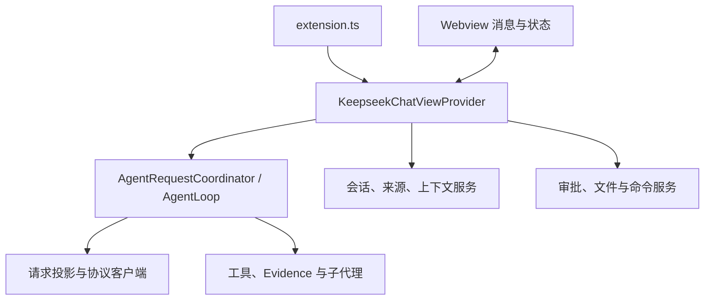

# KeepSeek 代码架构地图

本页按职责定位当前实现，不保存历史阶段的完整报告。开发约束见 [AGENTS.md](../AGENTS.md)，运行顺序见 [Agent 运行时](keepseek-agent-runtime-workflow.md)，专题与不同版本维度见 [文档导航](README.md)。源码与说明冲突时先追踪调用和测试。

## 1. 启动与依赖方向

KeepSeek 在 VS Code Extension Host 内运行。`package.json` 定义 commands/views/keybindings/menus、配置和 `main: ./out/extension.js`；[extension.ts](../src/extension.ts) 的 `activate()` 创建 `GlobalSessionStorage`、`ChatSessionStore`、`KeepseekChatViewProvider`，尽早注册 `keepseek.chat`，再异步初始化当前 workspace 的全新空白会话。生产接线显式传 `fresh: true`，只读 summary 索引，不恢复磁盘 active 或对象图；空白上下文延后至第一条已取得 task owner 的提交准备。配置、工作区、信任与文件事件由这里接线，不在激活入口放业务规则。

`src/provider/` 是 VS Code/Webview 协调层，`src/agent/providers/` 是上游 API 层。领域规则下沉到所属模块；底层服务不回调整个 Provider，也不另建授权、请求投影或副作用执行权威。

## 2. 宿主与 Webview

| 入口 | 当前职责 | 变更时一起核对 |
| --- | --- | --- |
| [KeepseekChatViewProvider.ts](../src/provider/KeepseekChatViewProvider.ts) | 生命周期、`handleMessage()`、`sendPromptImpl()`、会话和运行协调、审批队列、`postState()` | 对应领域 service、消息联合类型、Host 行为测试 |
| [interactionState.ts](../src/provider/interactionState.ts) | 操作预占/拥有者、等待原因、交互与独立标题能力派生 | 导航、提交、续跑/审批交接、状态 revision、Webview 生命周期 |
| [webviewMessages.ts](../src/provider/webviewMessages.ts) | 唯一 Webview → Host 消息联合类型 | 发送 fragment 与 `handleMessage()`；Host 主动消息不加入此联合 |
| [modelSelection.ts](../src/provider/modelSelection.ts) | 主模型切换事务、运行限制、lane 影响 | catalog、session requestProtocol、replay |
| [requestTimeoutSettings.ts](../src/provider/requestTimeoutSettings.ts) | 统一模型请求超时设置 | config/i18n 与所有模型请求入口 |
| [html.ts](../src/webview/html.ts) | CSP、nonce、资源 URI、首次 ready bootstrap | ready 之前的消息暂存和初始化门禁 |
| [script.ts](../src/webview/script.ts) | transcript、会话、状态/设置渲染、Host 消息监听 | DOM id、状态投影、编辑重发、Apply/Discard |
| [input/composition.ts](../src/webview/input/composition.ts) | 输入模板、样式、脚本 fragment 固定拼装顺序 | 同一 IIFE 的词法依赖和监听顺序；优先保持生成字节 |
| [richTextShortcuts.ts](../src/webview/richTextShortcuts.ts) | 两个编辑器共享 Emacs 命令、内存杀环与 yank-pop 边界 | 输入框与编辑重发的键盘/焦点行为 |
| [richTextContextMenu.ts](../src/webview/richTextContextMenu.ts)、[richTextContextMenuStyles.ts](../src/webview/richTextContextMenuStyles.ts) | 编辑器右键菜单、主题与焦点；调用共享命令 | C-w / M-w / C-y / M-y 提示与真实行为一致 |

Webview 是字符串生成的页面，不是独立前端应用。`input/composer/` 管编辑/序列化，`references/` 管引用与拖拽，`commandMenu/` 管菜单，`usage/` 管用量详情，`dialogs/` 管各设置对话框。样式、模板、行为保持各自 fragment 所有权。

容器默认贡献到 `viewsContainers.secondarySidebar`（最低 VS Code 1.106），沿用 `keepseek-sidebar` / `keepseek.chat` 身份与集中 `focusView()`。横向布局显式清除宿主注入的 body padding，再由各顶层区域各自消费一次统一 gutter；composer 内的菜单不重复消费。规则、宿主样式回归及旧用户位置边界见 [Webview 布局](keepseek-webview-layout.md)。

首次 `ready` 先获得轻量状态；会话与副作用恢复未就绪时拒绝相关写操作。消息 type、DOM id、引用格式、CSP/转义和公开控制接口都是行为契约。

轻量状态、完整状态和 patch 共用宿主派生的 `interaction`：编辑、提交、导航和取消分别表达；导航/准备/保存不等于模型运行。状态与提交反馈绑定会话和 revision/requestId，持续提示跟随有效操作而不依赖通知计时器。`isStartingRun` 只读派生互斥；旧 `isBusy` 兼容字段不能重新成为输入框权威。标题刷新单独消费 Host 的 `titleRegenerationCapability`，不把当前上下文等待等同于命名不可用；所有状态补丁定点同步历史行按钮。首次导航只跨 session/安全初始化屏障，余额磁盘展示在模型目录关键路径之外。具体拥有者、接受屏障和后台工作规则见 [交互生命周期](keepseek-interaction-lifecycle.md)。

当前菜单 `/` → 审批模式只有 ask/delegate；`/` → 子代理模型 → 审批模型与其他模型选择共用交互层级，但审批配置单独取用户级 `kmvdata.keepseek.autoApprovalReviewer`。普通子代理 default/research/review/proposal 不为审批 reviewer 提供默认值。

## 3. 来源、上下文与 Skills

| 模块 | 权威职责 |
| --- | --- |
| [accountStore.ts](../src/accounts/accountStore.ts)、[modelSourceService.ts](../src/accounts/modelSourceService.ts) | 来源 CRUD、缓存与面向 UI 的来源操作 |
| [accountResolver.ts](../src/accounts/accountResolver.ts) | 凭据、endpoint、协议与来源语义的唯一运行时解析入口；主请求、摘要、reviewer、child、发现和余额共用 |
| [modelCatalog.ts](../src/accounts/modelCatalog.ts)、[defaultModelStore.ts](../src/accounts/defaultModelStore.ts) | sourceId+modelId 身份、能力、全局默认与项目选择 |
| [subagentSettingsStore.ts](../src/accounts/subagentSettingsStore.ts)、[subagentModelResolver.ts](../src/accounts/subagentModelResolver.ts) | 普通子代理设置和运行前冻结 |
| [sharedConfigPaths.ts](../src/context/sharedConfigPaths.ts)、[sharedCodexConfig.ts](../src/context/sharedCodexConfig.ts) | 宿主路径/Git scope、有界读取、TOML 白名单和来源诊断 |
| [SharedProjectSources](../src/context/sharedProjectSources.ts)、[projectInstructions.ts](../src/agent/projectInstructions.ts) | 全局与任务 root→cwd 指令、普通 Skills 和配置的受控快照 |
| [promptReferences.ts](../src/context/references/promptReferences.ts) | 目录→文件→Skill 的展开顺序；外部精确 URI 授权 |
| [currentRunContext.ts](../src/agent/currentRunContext.ts)、[contextDeduplication.ts](../src/agent/contextDeduplication.ts) | 当前上下文拼装与去重，稳定 `contextInstructions` |
| [skillDiscovery.ts](../src/skills/skillDiscovery.ts)、[skillMetadata.ts](../src/skills/skillMetadata.ts) | 标准 `.agents/skills` 根发现、YAML 元数据和策略 |
| [skillActivationResolver.ts](../src/skills/skillActivationResolver.ts)、[skillLoader.ts](../src/skills/skillLoader.ts) | explicit→session→workspace-default→implicit；有界读取与隐式冻结 |
| [codexPluginSupport.ts](../src/skills/codexPluginSupport.ts)、[codexPluginDiscovery.ts](../src/skills/codexPluginDiscovery.ts)、[codexPluginResources.ts](../src/skills/codexPluginResources.ts)、[pluginSkillRuntime.ts](../src/agent/pluginSkillRuntime.ts) | 插件 Skills 暂停开关；安装/资源底层和历史数据保留，当前不发现、不加载、不执行或恢复插件任务 |

共享来源缓存只复用有界、可失效的读取快照；同版本并发读取合并，不同版本的 Skill 扫描通过独立 `discoverSnapshot()` 和 diagnostics 避免旧来源阻塞新来源。会话激活、冻结 implicit 集合、权限与错误状态仍归各自拥有者，不能作为共享缓存数据。普通导航不重算热会话的冻结集合，来源 dirty/force、信任/目录/配置变化和重启按受控边界重验。

任务目录来自用户选择或单根默认，不随焦点/附件变化。共享文件只读；发现/加载 Skill 不执行 scripts。普通项目 Skill 创建只准备 `SKILL.md` 与 `agents/openai.yaml` 的 ChangeSet，实际落盘仍走文件审批。插件入口不扩大通用文件、cwd、child 或写入授权。

不读取 `.keepseek/memory.json` 或 `legacy-memory` 旧数据。当前 `contextInstructions` 保存会话稳定上下文字节，普通追加和恢复不得重写。

共享子集与版本差异查 [共享配置](keepseek-codex-shared-config.md)，插件安装与能力边界查 [插件 Skills](keepseek-codex-plugin-skills.md)，引用语法查 [文件引用](keepseek-file-reference-spec.md)。

## 4. 请求、循环与长任务

| 关注点 | 权威入口 | 数据与边界 |
| --- | --- | --- |
| 请求快照 | [AgentRequestCoordinator](../src/agent/agentRequestCoordinator.ts) | 会话快照、归档与摘要刷新；送入 Runner |
| 活根预算 | [taskBudget.ts](../src/agent/taskBudget.ts) | 提交后、压缩前准备实际 run/cost 权威；配置与旧 root 限制共同收紧；原对象注入 Runner，不能序列化或另开额度 |
| 主循环 | [runner.ts](../src/agent/runner.ts) 的 `AgentLoop` / `AgentRunner` | 模型轮、工具路由、容量/epoch、输出接续；只生成 DraftEdit/DraftRun |
| 静态字节 | [protocol.ts](../src/agent/protocol.ts) | system、工具名称/排序/schema、持久化 user 展开字节 |
| 三协议投影 | [providerRequestProjection.ts](../src/agent/providerRequestProjection.ts) 的 `buildProviderRequestProjection()` | 实际 payload、token 估算、压缩、准入与硬上限共用；禁止分别重建 messages/tools |
| 历史投影 | [historyProjection.ts](../src/agent/historyProjection.ts)、[historyCompressor.ts](../src/agent/historyCompressor.ts)、[historyArchive.ts](../src/agent/historyArchive.ts) | 摘要与保护/近期消息只改变 projection；UI 历史 append-only |
| 容量与输出 | [outputBudget.ts](../src/shared/outputBudget.ts)、[requestBudget.ts](../src/agent/requestBudget.ts)、[toolResultAdmission.ts](../src/agent/toolResultAdmission.ts) | 用户模型输出上限、真实投影、来源隔离有效窗口；不恢复固定累计结果预算 |
| context-too-long | [contextWindowCalibrationStore.ts](../src/agent/contextWindowCalibrationStore.ts) | 按 source/endpoint/model 校准；无进展要改变策略 |
| Evidence | [evidence/store.ts](../src/agent/evidence/store.ts)、[shaping.ts](../src/agent/evidence/shaping.ts) | intent→执行→完整 evidence/hash→一次固定 Provider-visible envelope；分页/作用域复核 |
| epoch/恢复 | [contextEpoch.ts](../src/agent/contextEpoch.ts)、[runCheckpoint.ts](../src/agent/runCheckpoint.ts) | 同 task 保留计划、幂等、审批、副作用、验证和用量；已完成工具不重跑、未知副作用不重试 |
| 执行控制 | [executionMode.ts](../src/agent/executionMode.ts)、[executionPolicy.ts](../src/agent/executionPolicy.ts)、[repairLoop.ts](../src/agent/repairLoop.ts)、[backgroundRunCoordinator.ts](../src/agent/backgroundRunCoordinator.ts) | normal/plan 与审批正交，预算 grant、修复和显式后台任务 |

`providers/factory.ts` 根据来源选择客户端；Chat Completions、OpenAI Responses、Anthropic Messages 各有请求/流解析实现。`toolRounds` 保存 Chat Completions 工具轮，`providerReplay` 保存 Responses/Anthropic 原生块；仅同 protocol/source/endpoint lane 回放。Ollama 与官方预设的差异留在客户端/能力层。

`agent/tools/` 负责 workspace/semantic/Git 读取和固定 compile/lint/test 验证。schema 在 `protocol.ts`，Runner 负责分发，独立 service 负责具体实现；Git mutation 只能生成 DraftRun。

调用链：真实 user → 引用展开与同字节持久化 → Coordinator → Runner → 唯一请求投影 → 原生客户端 → 工具事务/Evidence → `AgentResponse` → Provider 保存消息/replay/用量并推送状态。摘要刷新与 epoch 是受控缓存边界，不是新任务或授权。

## 5. 审批与副作用

| 子系统 | 当前职责 |
| --- | --- |
| [approvalMode.ts](../src/agent/approvalMode.ts) | ask/delegate 归一化、稳定 user-tail、易失性 `DelegatedApprovalQueue` |
| [approvalReviewTypes.ts](../src/approvals/approvalReviewTypes.ts)、[approvalReviewHash.ts](../src/approvals/approvalReviewHash.ts)、[approvalReviewSurface.ts](../src/approvals/approvalReviewSurface.ts) | 精确 action、完整 canonical hash、有界 review 面 |
| [authorization/](../src/approvals/authorization/index.ts) | 信任、外部精确范围、实际程序/环境身份、command effects、实时 preflight 和最终复核 |
| [approvalPolicy.ts](../src/approvals/approvalPolicy.ts)、[approvalReviewer.ts](../src/approvals/approvalReviewer.ts)、[oneShotTextRequest.ts](../src/approvals/oneShotTextRequest.ts) | 独立无工具 reviewer、v9 决定、来源解析、占位认领与真实记录 |
| [manualApproval.ts](../src/approvals/manualApproval.ts)、[approvalProcessing.ts](../src/approvals/approvalProcessing.ts) | runtime 绑定的单次人工决定与持久化等待摘要；`createApprovalProcessing()` / `isCompletedApprovalBatch()` 管批次初始化与幂等判定、依赖及有界补规划状态 |
| [approvalReviewStore.ts](../src/approvals/approvalReviewStore.ts)、[approvalCircuitBreaker.ts](../src/approvals/approvalCircuitBreaker.ts) | append-only 审计、消费绑定、拒绝熔断 |
| [draftEdit.ts](../src/edits/draftEdit.ts)、[textPatch.ts](../src/edits/textPatch.ts) | 版本化 DraftEdit 与 canonical byte hunks；URI/base/result hash/size/encoding/EOL 是 Apply 权威 |
| [changeSetStore.ts](../src/edits/changeSetStore.ts)、[safeFileEditor.ts](../src/edits/safeFileEditor.ts) | ChangeSet 状态、preflight、prepared journal、base 复核、原子替换与 read-back；大内容由 artifact store 寻址 |
| [draftRunProposal.ts](../src/runs/draftRunProposal.ts)、[draftRunStore.ts](../src/runs/draftRunStore.ts) | immutable executable/argv/cwd/env/specHash、pending/运行/终态与输出 |
| [draftRunAuthorization.ts](../src/runs/draftRunAuthorization.ts)、[draftRunExecutor.ts](../src/runs/draftRunExecutor.ts)、[projectExecutionIsolation.ts](../src/runs/projectExecutionIsolation.ts) | 短时单次 permit、项目执行边界、字面启动计划与 `spawn(..., { shell:false })`、取消/超时 |
| [gitReleaseBatch.ts](../src/runs/gitReleaseBatch.ts)、[gitReleaseAuthorization.ts](../src/runs/gitReleaseAuthorization.ts)、[localGitCommit.ts](../src/runs/localGitCommit.ts)、[gitTransportEnvironment.ts](../src/runs/gitTransportEnvironment.ts) | Git 本地提交与发布的任务意图、依赖、证据和范围。受控传输沿用 DraftRun 的审批、许可和派发记录。 |

ask 由用户逐项或批量批准，零审批模型请求。delegate 的受审文件操作、DraftRun、固定验证和外部读取先过宿主安全检查，再由独立 reviewer 审查精确操作。工程范围和实际启动身份已核实时，陌生命令参数只提供语义证据。依赖本轮文件变更的启动在 Apply 和落盘核验后才形成审查快照。精确用户授权、模型决定和执行许可分别核验。历史 `host_policy` 保留审计，适用的安全拒绝继续约束两种模式。

所有路径保留信任、外部 URI/cwd、脏编辑器、hash/状态、取消等硬检查。delegate 本地命令与固定验证默认使用平台隔离，用户可在机器级设置中显式选择宿主权限执行。受控 Git 传输绑定实际远端、refs 和源对象，隔离环境与发布计划均进入审批快照。重启恢复说明与可证明状态，重新核验后生成新的审批与执行许可。决定和真实结果只追加到下一条真实 user 的固定 tail。

文件链：模型草案 → ChangeSet → 审批/Apply → SafeFileEditor → journal/hash/原子写/read-back → 真实结果。命令链：模型草案 → pending DraftRun → 审批 → 单次 permit → executor → 终态。Runner/Provider 不直接写工作区；shell 语法必须以 shell executable 与完整 argv 可见。

## 6. 子代理与用量

`SubagentRuntime` 为每个 child 创建新的 AgentLoop/工具服务。`scheduler.ts` 管深度、并发、数量和 proposal 槽位；`profiles.ts` 管研究/代码审查/提案能力；`pathScope.ts` 管路径租约。child 接收自包含任务、项目/profile 和精确授权，不复制父历史、推理或兄弟可变状态；proposal 只准备，不 Apply/批准/执行。

`delegation.ts` 保存候选/依赖/父采纳；`contextCapsule.ts` 保存宿主继承证明；`resultEnvelope.ts` 做结构签收，`handoff.ts` 交付有界 manifest，`resultIndex.ts` 保存 canonical 结果与 UTF-8 分页，`store.ts` 管持久化与恢复。`resultRef` 指 canonical 结果，`evidenceRef` 指不可变交付快照。完整权限与父验收见 [SUBAGENTS](../SUBAGENTS.md)。

用量权威分层：`usageLedger.ts` / `usageLedgerStore.ts` 保存请求级幂等账本；`usageStats.ts` 聚合官方/参考费用与缓存数据；`subagentUsageStats.ts` 归集 child；`cacheObservation.ts` 记录前缀指纹。`ExecutionClock` / `ExecutionCostBudget` 与 `sessions/userTaskBudget.ts` 保护跨 child、续跑、恢复、epoch 的根任务上限；逻辑任务有效计时由 `sessions/executionTimeStats.ts`、`userTask.ts` 管理，UI 投影不能重定义口径。正费用上限遇不可计价来源 fail-closed。

## 7. 会话、持久化与数据权威

| 模块/数据 | 权威与边界 |
| --- | --- |
| [chatSessionStore.ts](../src/sessions/chatSessionStore.ts) | 当前 workspace 会话门面、内存状态、选择与保存协调；除原生 replay 外的当前格式校验仍在此 |
| [sessionTitle.ts](../src/sessions/sessionTitle.ts)、[sessionTitleCoordinator.ts](../src/sessions/sessionTitleCoordinator.ts) | 唯一标题元数据、永久停止与独立 attempt；消费前缀游标/近期身份；共享真实用户输入识别；自动单条/手动最多两条 user-only material/basis；串行请求、用户抢占和过期提交保护 |
| [providerReplayNormalization.ts](../src/sessions/providerReplayNormalization.ts) | 原生 Responses/Anthropic replay 的纯完整校验、容量限制和复制；Store/Provider 共用，禁止接受部分非法 replay |
| [globalSessionStorage.ts](../src/sessions/globalSessionStorage.ts) | 按 workspace/session 分片的持久化 adapter，索引/全局 manifest V2 |
| [sessionObjectStore.ts](../src/sessions/sessionObjectStore.ts) | session shard V4 对象图、hash/scope/revision/写锁、对象先于 manifest 提交；不读取旧 shard |
| [persistenceSnapshot.ts](../src/sessions/persistenceSnapshot.ts)、[coalescedWriter.ts](../src/sessions/coalescedWriter.ts) | 不可变复用/可变状态复制、保存队列与失败/flush 语义；不能替换为普通 debounce |
| [sessionRetention.ts](../src/sessions/sessionRetention.ts) | 过期清理、保留策略与状态审计 |
| `ChatSession.messages` | UI 持久历史，append-only；`contextCompression` / `historyArchive` 仅是请求投影状态 |
| `requestProtocol` / `contextInstructions` | 冻结 lane/工具 schema 与稳定上下文字节；normalizer 不反写旧前缀 |
| `runCheckpoint` / `runCheckpointArchive` | 当前可恢复状态与归档引用；普通加载仅展开最新未结束 checkpoint，UI 不接收完整对象图 |

标题的 Host 候选由真实用户指令跨过提交保存屏障后制造，与主请求并行 drain，不等待助手回答或前台 owner 释放；启动/历史/诊断只读不补发。自动仅取本条 user.content，手动只惰性加载目标并冻结最近最多两条 user.content，不携带 assistant、全历史、摘要或展开内容。新 user_inputs_v3 basis 只绑定所选 user ID/hash，助手变化不使其过期；不接受旧 recent_turns_v2/whole-history basis。首次合格标题及 stopped 跨 shard/index staged commit 后永久停止，普通追加/切换不取消有效 attempt，截断/归档不解锁已提交标题；当前 canonical commit 必须核验，shard-only 不算成功。请求固定无工具、一次 set/defer，目的导向，标题专属 512 输出/30 秒上限；`prepareAgentTaskBudget()` 在用户提交后、预运行压缩前准备实际 root 的同一 run/cost 活对象并注入 Runner；无有限费用/token 上限且至少有两次请求余量时可先开放标题，否则等主请求首次预占耐久的短预算门，不能等整个标题响应；真实用户 recovery 补充的命名消息身份与原执行预算 root 分离、已花额度不重置；手动仍用独立窄预算，reviewer 合同不变。实现边界与原生请求计数验收见[会话标题](keepseek-session-title-verification.md)。

所有 Store 共用 `shared/storageRoot.ts` 解析的宿主原生 `file:` 根（`com.kmvdata.keepseek`）。扩展身份为 `keepseek.keepseek`，不读取旧扩展数据或执行跨版迁移。来源/子代理设置、当前会话索引与 V4 shard、evidence/child、用量账本、ChangeSet、DraftRun 和审批文件各由所属 Store 管理。JSON 优先 `writeJsonAtomic()`；未知副作用不自动重试。身份、格式矩阵和重置方式见[存储基线](keepseek-storage-baseline.md)。

## 8. 改动与测试路由

| 改动 | 首要入口 | 必须联查的现有回归 |
| --- | --- | --- |
| 配置/来源/模型 | package contributions、`shared/config.ts`、`accounts/` | `config`、`accountResolver`、`modelCatalog`、`modelSelection` |
| Provider payload/replay/预算 | `providerRequestProjection.ts`、`protocol.ts`、`providers/` | `cacheByteStability`、`protocolCache`、`modelLaneMigration`、三协议测试、`modelOutputBudget` |
| 工具/evidence/epoch | `protocol.ts`、Runner 路由、独立 service | `toolResultBudget`、`p1ProtocolDelivery`、`longRunningAgent`、恢复测试 |
| 审批/文件/命令 | `approvals/`、`edits/`、`runs/` | `approvalMode`、`approvalReviewer`、`taskApprovalIntegration`、`toolAuthorization`、`applyWorkflow`、`draftRun*` |
| 子代理 | `subagents/`、resolver、delegation | `subagentSafety`、`p1Delegation`、`p1SubagentInheritance`、`p1SubagentResultReader`、`subagentUsageRuntime` |
| 引用/Skills/输入 | `context/references/`、`skills/`、`webview/input/` | `fileReference`、`skill*`、`codexPlugin*`、`inputComposition`、`richTextShortcuts` |
| 交互/导航/后台工作 | `provider/interactionState.ts`、Provider 接线、Webview 状态入口 | `sessionNavigation`、`inputComposition`；拥有者/迟到结果、提交闭环与保存故障测试 |
| 会话结构/保存 | `shared/types.ts`、`sessions/`、checkpoint | `chatSessionStore`、`longTaskPerformance`、`p0SubagentPersistence`、`executionTimeStats` |
| 用量/观测 | ledger、usage、logging | `usageStats`、`subagentUsageStats`、`interactionTrace`、`runDetails` |
| 打包/资源 | `.vscodeignore`、`scripts/package-market.js`、`verify-vsix.js` | 市场包入口/依赖/动态 SVG 清单及包内容比较 |

测试文件统一位于 `test/<name>.test.ts`，默认执行清单在 `test/runTests.ts`。当前协议字节、不同 provider/scope 和故障时序各有独立行为合同；旧协议 fixture 不再属于运行时验收。独立脚本保留各自使用入口；运行前检查网络、报告写入和文件副作用。

默认验证：compile、lint、build:test、test、package:market；变更前先搜索全引用和消息/工具字符串，明确不变式，选择最接近的行为回归。真实模型、原生 UI 与跨平台验证应单列现场证据。历史记录及适用范围统一从 [文档导航](README.md#历史证据) 按需进入。

手动历史清理使用独立规则/操作日志、跨进程删除权威与所属 Store 定向回收；显示范围和 60 天自动保留语义不变。锁顺序、数据清单、恢复与能力边界见 [历史清理](keepseek-history-cleanup.md)。
